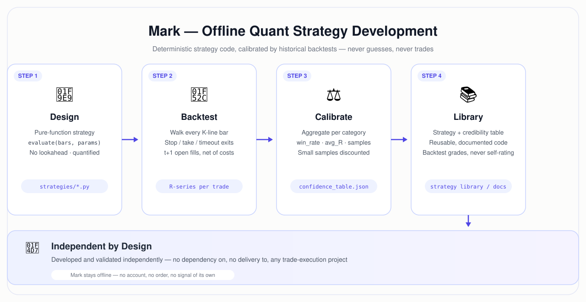

  

<h1 align="center">Mark — Quant Strategy Agent (HK / US Equities)</h1>

  
  
  
  

🌐 <a href="README_cn.md">简体中文</a>

**Mark** is a personified AI agent dedicated to **quantitative strategy development** for Hong Kong and US equities, built on [Claude Code](https://claude.com/claude-code). It designs backtestable trading strategies as deterministic code, runs them against years of historical data to calibrate their credibility. Strategies are **developed independently** — no dependency on, and no delivery to, any trade-execution project.

> This repository is the **main repository** (the agent project) of the Mark system: the agent's operating discipline (AGENTS.md), methodology, and open components. The active intraday research lives in the **`Intraday/` directory** of this repository (see [Repository Landscape](#repository-landscape)).

---

## Core Methodology

The edge comes from mathematical rigor that can be reproduced:

- **Fully quantified output.** Every field is a number or a finite enum — no qualitative prose ("momentum weakening"). This is what separates quant from discretionary.
- **Backtest-validated credibility.** A strategy does not grade itself; its confidence comes from historically measured win-rate / avg-R of its signal category.
- **Pure functions, no lookahead.** Same bars + same params → same output, always. No future data leaks into a decision.
- **Honest negative results.** Falsified ideas are documented, not buried — see the "already falsified" section of any strategy doc (e.g. [`Swing/trend/STRATEGY.md`](Swing/trend/STRATEGY.md)).
- **Walk-forward, multi-year validation.** In-sample means nothing; out-of-sample with zero degradation is the bar.

  

## Repository Landscape

One repository holds the agent project **and** the three research projects. They used to be separate repositories; since 2026-11-08 they live here as directories. The old repositories remain online as read-only archives, and they keep their full commit history — this repository took the content over in a single commit.

| Directory | What it is |
|---|---|
| **[`Swing/`](Swing)** | Day-K trend-following strategy — **complete documentation** (logic, params, 20-year × 37-stock backtest, honest caveats, falsified alternatives) |
| **[`gridtrader/`](gridtrader)** | Grid-trading strategy development & backtesting tool (Python / backtrader) |
| **[`Intraday/`](Intraday)** | Active intraday research (order-flow features, minute-level ML signals, walk-forward validation) |

Each directory carries its own `AGENTS.md` with the hard rules specific to it; version and change log are those of this repository (`VERSION` / `CHANGELOG.md` at the root).

## Part of the xhqing Agent Team

Mark is a member of the [xhqing AI agent team](https://github.com/xhqing) — a fleet of personified agents covering product research, digital production, growth, trading, legal, QA and more. See the [team overview](https://github.com/xhqing) for the full roster.

## Disclaimer

Strategy research for educational purposes. Nothing here is investment advice; backtests do not guarantee live or future performance.

## License & Attribution

- **Copyright** (c) 2026 xhqing and contributors. Licensed under the [MIT License](LICENSE.md).
- **Attribution**: If you reference or build upon this work, please keep the copyright notice and credit the source repository.
- **Citation**: <https://github.com/xhqing/quant-agent>
